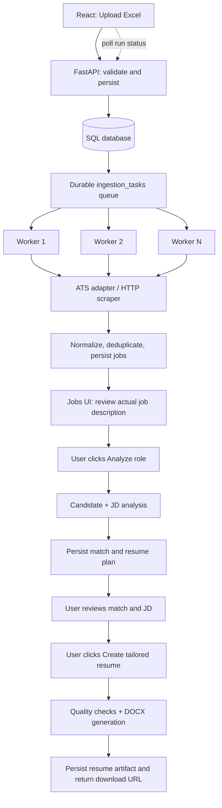

# Asynchronous Job Ingestion and Resume Creation

## Goals

1. Make Excel upload return quickly regardless of how slow a careers site is.
2. Persist every company scrape task so progress survives API restarts.
3. Distribute independent tasks across concurrent worker loops without assigning work manually.
4. Retry transient failures, record permanent failures, and expose progress to the UI.
5. Never generate a DOCX during discovery or matching. Generate it only after the user reviews a job description and clicks **Create tailored resume**.

## Architecture



## Current implementation in this slice

- `POST /companies/import` validates the workbook, upserts company records, creates a persisted ingestion run and scrape tasks, then returns HTTP 202. It does not scrape or run the candidate pipeline in the request.
- `GET /companies/import-runs/{run_id}` exposes run state, task counts, worker IDs, attempts, discovered job counts, and errors.
- `app/workers/ingestion_worker.py` runs independent worker loops. Workers claim the oldest queued task with a conditional database update; competing workers cannot claim the same task.
- Each company scrape runs in its own database session. The worker only discovers and persists jobs. Analysis is intentionally user-triggered from the Jobs page so each account is evaluated against its own candidate profile.
- Transient errors are retried up to three attempts. Terminal errors remain visible in the run status.
- The Companies UI polls the progress endpoint and displays task counts, completion percentage, and warnings when no valid jobs are discovered.
- Generic crawling checks structured JobPosting data, links, and sitemaps, discovers linked Greenhouse/Lever/Ashby boards, and uses Playwright as a fallback for JavaScript-rendered sites. Placeholder records with short descriptions or careers-index URLs are rejected.
- When Supabase credentials are configured, FastAPI validates bearer tokens against Supabase Auth. Candidate profiles, resume artifacts, pipeline results, application tracking, and ingestion progress are scoped to the signed-in account. Supabase profile data is protected by RLS.
- Pipeline execution now stores the resume plan but does not write a DOCX.
- `POST /resumes/tailor/{job_id}` reads the latest completed plan, performs resume quality checks, creates the DOCX, persists the artifact, and returns its download URL. The Jobs UI exposes this action after analysis and includes a full job-description disclosure.

## Worker execution

Run the API and worker as separate processes against the same database:

```bash
uvicorn app.main:app --reload
python -m app.workers.ingestion_worker --workers 4
```

The worker uses the configured database URL. SQLite is suitable for local single-machine development; PostgreSQL is recommended for concurrent workers and production. Keep the worker process running while ingestion tasks are expected to execute.

## Scheduling and load balancing

The first implementation uses a database-backed work queue with **oldest-queued-first claiming** and multiple concurrent worker loops. The conditional status update is the ownership guard. This is intentionally simpler than a custom least-loaded scheduler: when every worker consumes from one queue, idle workers naturally take the next available task. Slow sites do not block unrelated company tasks.

Before increasing worker count, add and validate:
- per-domain concurrency and request-rate limits;
- request timeouts and bounded exponential backoff in each source adapter;
- stale-running-task recovery after worker crashes;
- task idempotency keys and uniqueness constraints for queued work;
- queue latency, retry, and per-source failure metrics;
- adaptive per-domain rate limits and browser concurrency for JavaScript-rendered career pages.

## Failure states and semantics

- `queued`: persisted and waiting for a worker.
- `running`: claimed by a worker.
- `completed`: scrape succeeded and one or more valid postings were stored.
- `completed_with_warnings`: the crawl finished but discovered no valid postings; inspect the warning for JavaScript rendering, access blocks, or an empty source.
- `failed`: retry limit exhausted; the error is preserved.
- `skipped`: a queued task was intentionally not processed because its prerequisite disappeared.

A run becomes `completed` when all scrape tasks succeed and `completed_with_errors` if a task fails, is skipped, or finishes with warnings. Job analysis and resume generation are separate user-triggered actions and are not included in the ingestion run.

## Validation checklist

1. Excel upload returns HTTP 202 before any remote scrape finishes.
2. Upload creates one scrape task per imported company.
3. Two or more workers claim distinct task IDs under concurrent load.
4. A failed scrape is retried and eventually shows its error in the run endpoint.
5. A scrape stores only postings with real URLs and sufficiently complete job descriptions; the Jobs page exposes the actual role link and a separate apply link when available.
6. Restarting the API does not delete queued tasks; the worker resumes persisted work.
7. Analyze role uses the authenticated user's candidate profile and a valid stored job description.
8. Pipeline analysis does not create a DOCX.
9. No DOCX exists until the user clicks Create tailored resume.
10. Resume generation returns a download URL only after quality validation passes.
11. Frontend progress counts match persisted task statuses.
12. With Supabase enabled, user A cannot read or update user B's candidate profile, pipeline run, resume artifact, or application tracking row.
